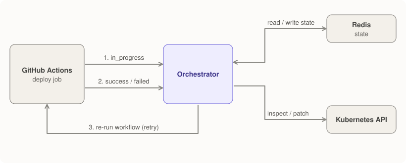
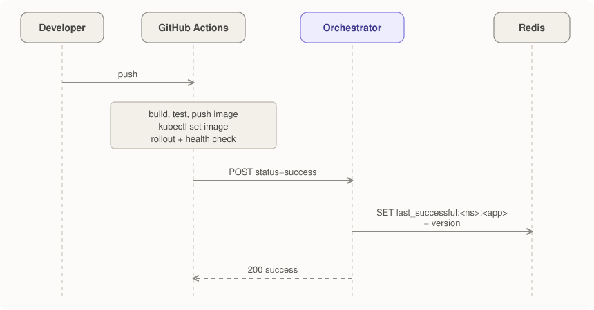

# Data Flow

This page traces how a deployment event travels through MANA, how the decision engine chooses between retry, rollback and alert, and what is stored along the way. For component responsibilities see [Components](components.md).

!!! info "Scope"
Everything here describes the behaviour of the code in `orchestrator/src/` and `.github/workflows/`. Where the implementation differs from the intended design, it is called out under [Known Behaviours and Limitations](#known-behaviours-and-limitations).

## Overview

MANA is **event-driven**. The orchestrator does not poll the cluster for new deployments; it reacts to webhooks that the CI/CD pipeline sends at key moments, and it consults Kubernetes and Redis only while handling an event.



## Webhook Contract

Every event is a `POST /webhook/deployment` with this JSON body (full schema in the [API Reference](../reference/api.md#post-webhookdeployment)):

```json
{
  "deployment_id": "deploy-3f2a…",
  "namespace": "production",
  "app_name": "sample-app",
  "version": "v1a2b3c4-1760000000",
  "status": "in_progress | success | failed",
  "failure_type": "health_check_failure",
  "metadata": {
    "commit": "…",
    "author": "…",
    "branch": "main",
    "workflow_run_id": "123456789"
  }
}
```

How the orchestrator reacts depends on `status`:

| `status`                       | Orchestrator behaviour                                                                                                                     |
| ------------------------------ | ------------------------------------------------------------------------------------------------------------------------------------------ |
| `in_progress`                  | Counts the event in `deployments_total`, stores the deployment as `in_progress` with its start time (a re-run reopens the existing state), returns `acknowledged`. A Redis error is logged and the event is still acknowledged |
| `success`                      | Marks the state `success` and stamps `finished_at` (creating the state if none exists), records `version` as the new last-known-good for `<namespace>/<app_name>`, returns `success` |
| `failed` (with `failure_type`) | Runs the failure-handling logic below                                                                                                      |
| anything else                  | Counted and acknowledged                                                                                                                   |

## Successful Deployment



The important side effect is `last_successful:<namespace>:<app_name>`. That value is what a later rollback restores.

## Failed Deployment


### The decision rule

After incrementing `retry_count`, `handle_deployment_failure()` evaluates these conditions **in order**:

1. **Retry**: `retry_count <= MAX_RETRIES`
   - Requires `workflow_run_id` in the state's `metadata`, which is filled from the failure webhook's own `metadata` and from earlier state for the same deployment ID. If it is missing, the result is **alert** instead.
   - Backoff is `INITIAL_BACKOFF × BACKOFF_MULTIPLIER^(retry_count - 1)`, capped at `MAX_BACKOFF`.
   - Status becomes `retry_scheduled`; a background task waits for the backoff, then calls the GitHub re-run API.
2. **Alert, nothing to roll back**: the failure is `build_failure` or `test_failure`. Nothing was deployed, so rollback is never attempted for these types.
3. **Rollback**: retries are exhausted **and** a previous version is known **and** the failed version is the one running
   - Before touching the cluster, the orchestrator reads the image tag the Deployment is running. If it equals the failed `version`, the rollback proceeds.
   - If another version is running (for example the failed version never reached the cluster, or someone already rolled back), the result is **skip**: nothing is changed, the status becomes `failed` and a `rollback_skipped` audit event is written.
   - If the live version cannot be read, or the image is pinned by digest so no tag can be compared, the result is **alert**.
   - Status becomes `rolling_back`, then `rolled_back` on success or `failed` if the rollback does not become healthy.
4. **Alert**: everything else (for example, no previous version is known)
   - Status becomes `failed` and a `manual_intervention_required` audit event is written.

With the defaults (`MAX_RETRIES=3`, `INITIAL_BACKOFF=10`, `BACKOFF_MULTIPLIER=2`):

| Failure # for this deployment ID | Action                                  | Delay |
| -------------------------------- | --------------------------------------- | ----- |
| 1                                | retry                                   | 10 s  |
| 2                                | retry                                   | 20 s  |
| 3                                | retry                                   | 40 s  |
| 4                                | rollback (if a previous version exists) | n/a   |
| 4, no previous version           | alert                                   | n/a   |

### Executing a rollback

`rollback_deployment()` performs these steps:

1. Read the Deployment from Kubernetes and find the application container: the one **named like the Deployment**, or the only container if there is exactly one. If neither applies, the rollback fails without changing anything.
2. Build the target image from the running one. The registry (including a port) and repository are preserved, the tag is replaced, and a digest is dropped.
3. `PATCH` only that container's image and the `version` labels (Deployment and pod template). Kubernetes performs a normal rolling update back to the old image.
4. Check that the Deployment reports the target image after the patch. If not, the rollback fails.
5. Wait for the new revision to finish rolling out (the controller observed the patched generation, every replica is updated and no old replicas remain), then for health (see below). Success writes `rollback_completed` to the audit log; failure writes `rollback_failed` and the decision becomes `alert`.

Any error during these steps, not only Kubernetes API errors, counts as a failed rollback and is recorded in `rollback_failed` with the error type. `rollback_initiated` records the version that was actually running.

### Previous-version resolution

`get_previous_version()` tries two strategies:

1. **Redis**: `last_successful:<namespace>:<app_name>`, written by the last `success` webhook.
2. **ReplicaSets**: the second-newest ReplicaSet (by creation time) that carries a `version` label.

If both fail, the result is `None` and the decision is `alert`.

### Health verification

`check_deployment_health()` loops (sleeping 10 s between iterations) until its timeout, which defaults to **300 seconds**:

1. Read the Deployment; continue unless `ready_replicas == spec.replicas`.
2. Once all replicas are ready, call `check_application_health()`: for each `Running` pod, `GET http://<pod-ip>:<HEALTH_CHECK_PORT><HEALTH_CHECK_PATH>`. A pod is healthy only if it returns HTTP 200 with JSON `{"status": "healthy"}`. The deployment passes if **at least one** pod is healthy.
3. If pods are ready but the application check fails **3 consecutive times**, the check returns `False` early.
4. A Kubernetes API error returns `False` immediately.

!!! note
`HEALTH_CHECK_TIMEOUT` (default 5) is the **per-request HTTP timeout** used when calling a pod, not the overall verification timeout. The overall timeout is the 300 s default of `check_deployment_health()` (or the `timeout` field of `POST /health-check`).

## Retry Mechanics

For a retry the orchestrator does not redeploy anything itself. It asks GitHub to re-run the failed workflow:

```
POST https://api.github.com/repos/<GITHUB_REPO>/actions/runs/<workflow_run_id>/rerun
Authorization: Bearer <GITHUB_TOKEN>
```

This happens in a background `asyncio` task after the backoff delay. Success is HTTP `201`; `403` is logged as a missing-permission error (the token needs the `actions:write` permission, or the classic `repo`/`workflow` scopes). The retry endpoint does not wait for the re-run to finish. The outcome arrives later as a new webhook from the re-run pipeline.

## State Model

Each deployment ID has one `DeploymentState` record stored as JSON under `deployment:<deployment_id>`:

| Field              | Type           | Meaning                                                   |
| ------------------ | -------------- | --------------------------------------------------------- |
| `deployment_id`    | string         | Unique ID generated by the pipeline                       |
| `namespace`        | string         | Target namespace                                          |
| `app_name`         | string         | Deployment name and `app` label                           |
| `version`          | string         | Version (image tag) being deployed                        |
| `status`           | enum           | See below                                                 |
| `previous_version` | string or null | Rollback target resolved when the state was first created |
| `retry_count`      | integer        | Number of failure events handled for this ID              |
| `failure_type`     | enum or null   | Most recent failure type                                  |
| `timestamp`        | float          | Unix time when the state was created                      |
| `metadata`         | object         | Free-form; holds `workflow_run_id` for retries            |

TTL is 24 hours and is refreshed every time the state is saved.

### Status lifecycle


`in_progress` is written when the `in_progress` webhook arrives and `pending` is never written. A state carries `started_at` (first `in_progress`), `first_failure_at` (first failed attempt) and `finished_at` (first save in a terminal status: `success`, `failed` or `rolled_back`; cleared when a re-run reopens the deployment). States saved before these fields existed still load, with the fields empty. Deployments that are `in_progress`, `retry_scheduled` or `rolling_back` are tracked in the Redis sorted set `mana:active`, scored by start time; entries older than the 24 h state TTL are dropped when it is read.

## Audit Trail

Each stage above emits an audit event so the full story of a deployment can be reconstructed by filtering on `deployment_id`:

`deployment_received` → `failure_detected` → `retry_initiated`, `rollback_initiated` or `rollback_skipped` → `health_check_started` → `health_check_passed`/`health_check_failed` → `rollback_completed`/`rollback_failed` → `state_saved` → `manual_intervention_required` (when a human is needed).

## Metrics Emitted

| Metric                                                | Updated when                                                      |
| ----------------------------------------------------- | ----------------------------------------------------------------- |
| `deployments_total{namespace,status}`                 | Every webhook                                                     |
| `retries_total{namespace,retry_attempt}`              | A retry is scheduled                                              |
| `rollbacks_total{namespace,reason}`                   | A rollback succeeds (`reason` is the `failure_type`, or `manual`) |
| `health_check_duration_seconds{namespace,deployment}` | `POST /health-check` completes                                    |

See [Monitoring](../usage/monitoring.md) for the complete list, including metrics that are declared but not yet populated.

## Known Behaviours and Limitations

These were found by reading the code and exercising the webhook endpoint against mocked Redis and Kubernetes clients. They are documented here so that operators are not surprised, and are good candidates for follow-up issues.

!!! note "1. GitHub re-runs apply to finished runs"
GitHub allows re-running a workflow run once it has completed. The webhook is sent from inside the running workflow, so the backoff delay must outlast the remaining steps or the re-run request may be rejected. Monitor the `retries_total` metric and orchestrator logs for `GitHub API permission denied` or non-201 responses.

!!! note "2. Build-stage failures have nothing to roll back"
`build-and-test.yml` reports `build_failure`/`test_failure` with `namespace: ci` and no `workflow_run_id`. These produce an `alert` because no Deployment exists to retry or roll back. The orchestrator also never rolls back for these two types, even when a `workflow_run_id` is present and retries are exhausted.
