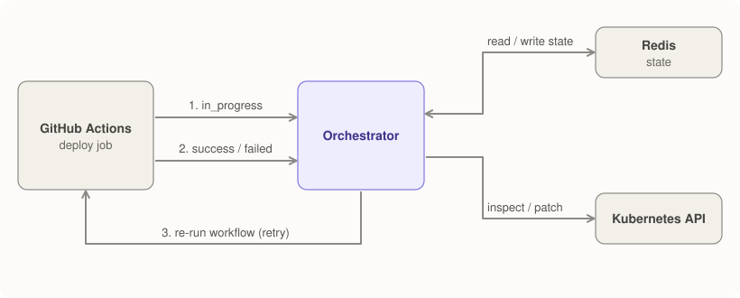
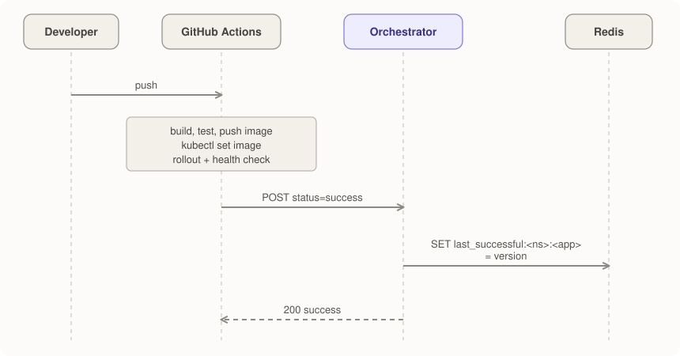

# Data Flow

This page traces how a deployment event travels through MANA, how the decision engine chooses between retry, rollback and alert, and what is stored along the way. For component responsibilities see [Components](components.md).

!!! info "Scope"
Everything here describes the behaviour of the code in `orchestrator/src/` and `.github/workflows/`. Where the implementation differs from the intended design, it is called out under [Known Behaviours and Limitations](#known-behaviours-and-limitations).

## Overview

MANA is **event-driven**. The orchestrator does not poll the cluster for new deployments; it reacts to webhooks that the CI/CD pipeline sends at key moments, and it consults Kubernetes and Redis only while handling an event.



## Webhook Contract

Every event is a `POST /webhook/deployment` with this JSON body (full schema in the [API Reference](../reference/api.md#post-webhookdeployment)):

```json
{
  "deployment_id": "deploy-3f2a…",
  "namespace": "production",
  "app_name": "sample-app",
  "version": "v1a2b3c4-1760000000",
  "status": "in_progress | success | failed",
  "failure_type": "health_check_failure",
  "metadata": {
    "commit": "…",
    "author": "…",
    "branch": "main",
    "workflow_run_id": "123456789"
  }
}
```

How the orchestrator reacts depends on `status`:

| `status`                       | Orchestrator behaviour                                                                                                                     |
| ------------------------------ | ------------------------------------------------------------------------------------------------------------------------------------------ |
| `in_progress`                  | Stores the deployment as `in_progress` with its start time (a re-run reopens the existing state), returns `acknowledged`. A Redis error is logged and the event is still acknowledged |
| `success`                      | Marks the state `success` and stamps `finished_at` (creating the state if none exists), records `version` as the new last-known-good for `<namespace>/<app_name>`, returns `success` |
| `failed` (with `failure_type`) | Runs the failure-handling logic below                                                                                                      |
| anything else                  | Counted and acknowledged                                                                                                                   |

## Successful Deployment



The important side effect is `last_successful:<namespace>:<app_name>`. That value is what a later rollback restores.

## Failed Deployment


### The decision rule

After incrementing `retry_count` (the number of failures for this deployment ID), `handle_deployment_failure()` gathers the facts and calls the pure function `decide()` from `src/policy.py`:

1. **Rule.** The [recovery policy](../configuration/recovery-policy.md) gives the rule for the failure type, from the first matching override or the default. `MAX_RETRIES` caps its retries.
2. **Diagnosis.** For failures after a deployment, the pods running the failed version and the Deployment are read (`src/diagnosis.py`). A transient cause (`ImagePullBackOff`, `Unschedulable`) leaves the rule alone; a deterministic one (`CrashLoopBackOff`, `OOMKilled`, ...) skips its retries. The diagnosis is stored in the state.
3. **Decision.** `decide(rule, attempt, can_retry, has_rollback_target, diagnosis)` returns `retry`, `rollback` or `alert` with a reason:
   - A **retry** rule retries while `attempt <= max_attempts`, a `workflow_run_id` is known and the diagnosis is not deterministic. Otherwise it continues with its `then` action (`rollback` or `alert`).
   - A **rollback** needs a previous version that is not the failed version; otherwise the result is an alert (`no_rollback_target`).
   - The decision is audited (`policy_decision`) and counted (`mana_policy_decisions_total`).
4. **Retry.** Backoff is `INITIAL_BACKOFF × BACKOFF_MULTIPLIER^(retry_count - 1)`, capped at `MAX_BACKOFF`. Status becomes `retry_scheduled` and a `retry_rerun` job is queued in Redis, due after the backoff. A scheduler on any replica claims it and calls the GitHub re-run API (see [Durable jobs](#durable-jobs)).
5. **Rollback.** First the circuit breaker is checked: too many recent rollbacks of the application turn the decision into an alert. Then, before touching the cluster, the orchestrator reads the image tag the Deployment is running:
   - If it equals the failed `version`, the status becomes `rolling_back` and a `rollback` job is queued, due at once, carrying the policy's verification timeout. The response is `action: rollback` and means *scheduled*. The job later sets `rolled_back` (and freezes the failed version on the deny-list), or `failed` if the rollback does not become healthy.
   - If another version is running (for example the failed version never reached the cluster, or someone already rolled back), the result is **skip**: nothing is changed, the status becomes `failed` and a `rollback_skipped` audit event is written.
   - If the live version cannot be read, or the image is pinned by digest so no tag can be compared, the result is **alert**.
6. **Alert.** The status becomes `failed`, a `manual_intervention_required` audit event is written and the alert channels are notified with the reason.

Stuck rollouts found by the [watcher](../configuration/recovery-policy.md#the-rollout-watcher) enter at step 1 as a `timeout` failure with the deployment ID `watch-<namespace>-<app>-g<generation>` and no workflow run, so a retry is not possible and the rule continues with its `then` action.

With the built-in policy (`INITIAL_BACKOFF=10`, `BACKOFF_MULTIPLIER=2`):

| Failure type           | Failure # | Action                                     | Delay |
| ---------------------- | --------- | ------------------------------------------ | ----- |
| `health_check_failure` | 1         | rollback (if a previous version exists)    | none  |
| `smoke_test_failure`   | 1         | rollback (if a previous version exists)    | none  |
| `deployment_failure`   | 1         | retry                                      | 10 s  |
| `deployment_failure`   | 2         | rollback (if a previous version exists)    | none  |
| `timeout`              | 1, 2      | retry, then rollback                       | 10 s  |
| `build_failure`        | 1, 2, 3   | retry, retry, alert                        | 10 s, 20 s |
| `test_failure`         | 1         | alert                                      | none  |
| any, no previous version | when it would roll back | alert                         | none  |

### Executing a rollback

`rollback_deployment()` performs these steps:

1. Read the Deployment from Kubernetes and find the application container: the one **named like the Deployment**, or the only container if there is exactly one. If neither applies, the rollback fails without changing anything.
2. Build the target image from the running one. The registry (including a port) and repository are preserved, the tag is replaced, and a digest is dropped.
3. `PATCH` only that container's image and the `version` labels (Deployment and pod template). Kubernetes performs a normal rolling update back to the old image.
4. Check that the Deployment reports the target image after the patch. If not, the rollback fails.
5. Wait for the new revision to finish rolling out (the controller observed the patched generation, every replica is updated and no old replicas remain), then for health (see below). Success writes `rollback_completed` to the audit log; failure writes `rollback_failed` and the decision becomes `alert`.

Any error during these steps, not only Kubernetes API errors, counts as a failed rollback and is recorded in `rollback_failed` with the error type. `rollback_initiated` records the version that was actually running.

### Previous-version resolution

`get_previous_version()` tries two strategies:

1. **Redis**: `last_successful:<namespace>:<app_name>`, written by the last `success` webhook.
2. **ReplicaSets**: the second-newest ReplicaSet (by creation time) that carries a `version` label.

If both fail, the result is `None` and the decision is `alert`.

### Health verification

`check_deployment_health()` loops (sleeping 10 s between iterations) until its timeout, which defaults to **300 seconds**:

1. Read the Deployment; continue unless `ready_replicas == spec.replicas`.
2. Once all replicas are ready, call `check_application_health()`: for each `Running` pod, `GET http://<pod-ip>:<HEALTH_CHECK_PORT><HEALTH_CHECK_PATH>`. A pod is healthy only if it returns HTTP 200 with JSON `{"status": "healthy"}`. The deployment passes if **at least one** pod is healthy.
3. If pods are ready but the application check fails **3 consecutive times**, the check returns `False` early.
4. A Kubernetes API error returns `False` immediately.

!!! note
`HEALTH_CHECK_TIMEOUT` (default 5) is the **per-request HTTP timeout** used when calling a pod, not the overall verification timeout. The overall timeout is the 300 s default of `check_deployment_health()` (or the `timeout` field of `POST /health-check`).

## Durable jobs

Retries, rollbacks and alerts run as jobs in Redis, never inside the webhook request.

| Key                    | Type       | Meaning                                                      |
| ---------------------- | ---------- | ------------------------------------------------------------ |
| `mana:jobs:pending`    | sorted set | Job ids scored by the time they are due                      |
| `mana:jobs:inflight`   | sorted set | Claimed job ids scored by the end of their lease             |
| `mana:job:<id>`        | JSON       | Kind, payload and attempt count (24 h TTL)                   |
| `mana:lock:rollback:<namespace>:<app>` | string | Per-application rollback lock (expires on its own) |
| `mana:delivery:<hash>` | JSON       | Claim and answer of a signed webhook (30 s while processing, 10 min after) |

1. A scheduler runs in every replica. It claims the oldest due job with one atomic Lua script that moves it from `pending` to `inflight` with a lease, so exactly one replica gets it. All times come from the Redis server, so replica clocks cannot disagree.
2. While the job runs, the lease is renewed every third of its length. If the replica dies, the lease expires, any replica moves the job back to `pending`, and it runs again. The attempt count then exceeds 1.
3. A job id is deterministic (`retry_rerun:<deployment>:<n>`, `rollback:<deployment>:<n>`), so queueing the same job twice adds one.
4. A job only acts while the deployment is still waiting for it: a retry job is skipped if the deployment has moved to a later step, so a stale job cannot re-run a succeeded deployment or fail one that moved on.
5. A failing job is retried with backoff up to `JOB_MAX_ATTEMPTS`. A job that raises *defer* (for example a rollback that finds the lock taken) waits and does not use an attempt. A job that gives up marks the deployment `failed`, writes `manual_intervention_required` and sends an alert.

The rollback job holds the per-application lock for its whole run, renewed in the background. It re-reads the live version under the lock. A first attempt that finds the *target* version already live means another rollback did the work and is skipped; a retried attempt that finds it live (the worker died after patching) goes on to verify the rollout instead, so the same rollback is never executed twice and a half-finished one is completed.

Not covered: if a replica dies in the milliseconds between saving a state and queueing its job, the job is lost and the deployment stays in that state until its 24 h TTL. The sender's own retry of the same signed request is recognised as a copy and not reprocessed.

## Retry Mechanics

For a retry the orchestrator does not redeploy anything itself. It asks GitHub to re-run the failed workflow:

```
POST https://api.github.com/repos/<GITHUB_REPO>/actions/runs/<workflow_run_id>/rerun
Authorization: Bearer <GITHUB_TOKEN>
```

This is done by the `retry_rerun` job once the backoff has passed. Success is HTTP `201`. `403` and `409` (the run may still be in progress, or the token lacks `actions:write`), `429`, `5xx` and network errors are retried with backoff; any other answer, or a missing token, fails the job at once (the token needs `actions:write`, or the classic `repo`/`workflow` scopes). The retry endpoint does not wait for the re-run to finish. The outcome arrives later as a new webhook from the re-run pipeline.

## State Model

Each deployment ID has one `DeploymentState` record stored as JSON under `deployment:<deployment_id>`:

| Field              | Type           | Meaning                                                   |
| ------------------ | -------------- | --------------------------------------------------------- |
| `deployment_id`    | string         | Unique ID generated by the pipeline                       |
| `namespace`        | string         | Target namespace                                          |
| `app_name`         | string         | Deployment name and `app` label                           |
| `version`          | string         | Version (image tag) being deployed                        |
| `status`           | enum           | See below                                                 |
| `previous_version` | string or null | Rollback target resolved when the state was first created |
| `retry_count`      | integer        | Number of failure events handled for this ID              |
| `failure_type`     | enum or null   | Most recent failure type                                  |
| `timestamp`        | float          | Unix time when the state was created                      |
| `metadata`         | object         | Free-form; holds `workflow_run_id` for retries            |

TTL is 24 hours and is refreshed every time the state is saved.

### Status lifecycle


`in_progress` is written when the `in_progress` webhook arrives and `pending` is never written. A state carries `started_at` (first `in_progress`), `first_failure_at` (first failed attempt) and `finished_at` (first save in a terminal status: `success`, `failed` or `rolled_back`; cleared when a re-run reopens the deployment). States saved before these fields existed still load, with the fields empty. Deployments that are `in_progress`, `retry_scheduled` or `rolling_back` are tracked in the Redis sorted set `mana:active`, scored by start time; entries older than the 24 h state TTL are dropped when it is read.

## Audit Trail

Each stage above emits an audit event so the full story of a deployment can be reconstructed by filtering on `deployment_id`:

`deployment_received` → `failure_detected` → `retry_initiated`, `rollback_initiated` or `rollback_skipped` → `health_check_started` → `health_check_passed`/`health_check_failed` → `rollback_completed`/`rollback_failed` → `state_saved` → `manual_intervention_required` (when a human is needed).

## Metrics Emitted

| Metric                                                      | Updated when                                                                  |
| ----------------------------------------------------------- | ----------------------------------------------------------------------------- |
| `deployments_total{namespace,status}`                       | A deployment moves into `success`, `failed` or `rolled_back`                  |
| `deployment_duration_seconds{namespace,status}`             | Same moment, when the first `in_progress` event was seen                      |
| `mana_recovery_duration_seconds{namespace,app,outcome}`     | A deployment that failed earlier succeeds, or a rollback is verified          |
| `rollback_decision_duration_seconds`                        | The orchestrator has chosen retry, rollback, skip or alert                    |
| `retries_total{namespace,retry_attempt}`                    | A retry is scheduled                                                          |
| `rollbacks_total{namespace,reason}`                         | A rollback succeeds (`reason` is the `failure_type`, or `manual`)             |
| `health_checks_total{namespace,result}` and `health_check_duration_seconds{namespace,deployment}` | A deployment health check finishes |
| `webhook_requests_total`, `webhook_errors_total`            | A request to `/webhook/*` is answered                                         |
| `redis_connection_errors_total`                             | A Redis call fails with a connection or timeout error                         |
| `active_deployments{namespace}`                             | Read from Redis when Prometheus scrapes                                       |

See [Monitoring](../usage/monitoring.md) for the complete list, including metrics that are declared but not yet populated.

## Known Behaviours and Limitations

These were found by reading the code and exercising the webhook endpoint against mocked Redis and Kubernetes clients. They are documented here so that operators are not surprised, and are good candidates for follow-up issues.

!!! note "1. GitHub re-runs apply to finished runs"
GitHub allows re-running a workflow run once it has completed. The webhook is sent from inside the running workflow, so the backoff delay must outlast the remaining steps or the re-run request may be rejected. Monitor the `retries_total` metric and orchestrator logs for `GitHub API permission denied` or non-201 responses.

!!! note "A run ID seen earlier counts"
`in_progress` webhooks store their `metadata`, so a `failed` webhook that omits `workflow_run_id` is still retried when the deployment's `in_progress` event carried it. The `alert` for a missing run ID only happens when no event for that deployment ever supplied one.

!!! note "2. Build-stage failures have nothing to roll back"
`build-and-test.yml` reports `build_failure`/`test_failure` with `namespace: ci` and no `workflow_run_id`. These produce an `alert` because no Deployment exists to retry or roll back. The orchestrator also never rolls back for these two types, even when a `workflow_run_id` is present and retries are exhausted.
